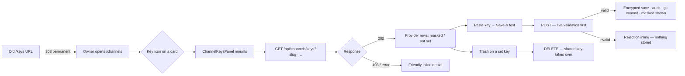

# keys-inline (#103) — feature report

Date: 2026-10-27 · Issue: #103 · Spec: `docs/superpowers/specs/2026-10-27-keys-inline-channels-spec.md` · QA: `docs/qa/keys-inline-channels-qa.md`

## What this feature does

API key management now lives on the Channels page, right inside each channel's card. The separate API Keys page is gone. When you configure a channel — scheduling, templates, anything — its keys are one click away on the same screen, and the template panel's "missing capability" fix message points at the key panel on the page you're already on.

## How it works, step by step

1. Open `/channels`. Every active channel card now has a key icon in its header row (next to the calendar, layers, pause and pen icons).
2. Click the key icon → an "API keys" panel expands under that card: one block per provider (Gemini, Groq, Cerebras, Mistral, HuggingFace, OpenAI, Pixabay, Pexels, OpenRouter, ElevenLabs), each showing a green `••••last4` when set, or "not set — shared key is used" when not.
3. Paste a key → **Save & test** → the key is validated live; if valid it's saved encrypted and the row shows its masked value; if rejected, the provider's own error shows inline and nothing is stored.
4. Trash icon on a set key removes it → "removed — shared key takes over".
5. The panel header line shows the last change (UTC timestamp + who) when the channel has key history.
6. Parked brands: click a parked tile → the same key panel opens full-width below the parked grid — so you can pre-load a brand's keys before waking it up.
7. Old `/keys` bookmarks land on `/channels` (permanent 308 redirect).
8. If the API denies access (e.g. wrong role for a channel), the panel shows the denial as a friendly inline message — never a spinner, never key material.

## How it was built

- **New**: `studio/components/ChannelKeysPanel.js` — behavior lifted unchanged from the retired `/keys` page (validate-before-save, AES-256-GCM at rest, masked read-back, audit + git commit per change). Providers come from the API's registry response — no hardcoded lists (no-static-maps rule). Fetches only while mounted, so the Channels page stays fast at ~30 cards.
- **Wired**: `studio/app/channels/page.js` — third panel toggle (key icon), same pattern as schedule/template panels; parked tiles became buttons opening the same panel below the grid.
- **Retired**: `studio/app/keys/` deleted; `next.config.mjs` adds a permanent 308 redirect; System nav drops the entry; `proxy.js` loses the dead `/keys` rule. The keys API itself: untouched.
- **Message**: template panel's missing-capability fix now says "add a key in this channel's API keys panel (key icon on its Channels card)".
- Commits: `32a4417` docs → `8c80ace` panel + wiring → `4ea8288` retire → `d8640eb` fix-message → `4547cf3` review fixes.

## QA guide in plain English

Full pack: `docs/qa/keys-inline-channels-qa.md` (17 rows). The quick version, as the owner:

1. `/channels` → key icon on each active card → click → panel expands inline with all 10 providers (desktop + mobile screenshot rows).
2. DevTools Network: no `/api/channels/keys` traffic until a panel opens; exactly one GET per open.
3. Paste `BAD-KEY-000` → Save & test → red "key rejected: …", status unchanged (already proven at API level at build time).
4. Save a real key → green "saved ••••last4", audit entry in `/logs`, new `api-keys:` commit in git; trash it → "shared key takes over".
5. Click a parked brand tile → key panel opens below the grid.
6. Visit `/keys` → lands on `/channels`; sidebar System group has no API Keys item.
7. If a template assignment blocks with "missing capability", the fix sentence points at the inline panel.

## Flow

## Evidence

- Tests: `node --test tests/*.mjs` → **173 pass / 0 fail** (vault regression included, 7/7).
- Build: `✓ Compiled successfully`, 25/25 pages, `/keys` absent from the route table.
- Redirect: `308 → /channels` verified unauthenticated, with stray query, and with owner session.
- Validate-before-save: `HTTP 400 {"error":"key rejected: HTTP 400"}`, state unchanged after.
- Review: spec-axis major (AC-12 spinner) fixed; standards axis APPROVE. Pre-existing lint/build warnings untouched and noted as backlog.

## What's next

- Owner executes the human QA rows (visual/manual) against the deployed Studio — issue #103 stays open, label flipped to `ready-for-human` until those pass.
- Backlog notes from review: shared save/remove logic with the client view's `KeysInline` (hook candidate); parked-tile active affordance could be stronger; pre-existing lint errors in `client/page.js` (lines 63, 196) and ~48 repo-wide lint errors predate this work.
- Next feature in the owner's queue per prior planning: none pinned for this lane — fleet key-coverage matrix remains an optional follow-up, own issue if wanted.
