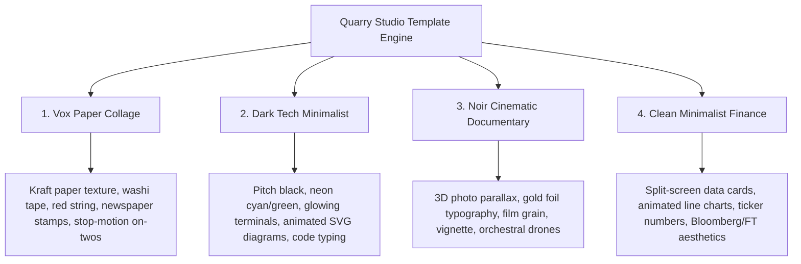

# Video Templates Architecture & Competitor Research (2026)
**Category:** Core Product Strategy & Long-Form Video Template Engine  
**Author:** AI Engineering & Research  
**Target:** Multi-Template Engine for Automated High-Retention YouTube Channels (Quarry Studio)

---

## 1. Executive Summary & Market Landscape

In 2026, **template quality is the #1 differentiator for faceless video SaaS products**.

The current market is saturated with cheap, robotic tools ($19–$49/mo like AutoShorts, Vsub, InVideo, Pictory, and Fliki). However, **customer reviews across Trustpilot and Reddit are consistently negative (2.9/5 to 3.5/5)**. The universal complaint is **"Template Sameness"**: every video looks like a flat slideshow of random stock footage with an ugly subtitle box pasted in the middle.

Top faceless YouTube channels that actually generate **millions of views and $10k–$50k/mo in ad revenue** (**MagnatesMedia**, **Vox**, **ColdFusion**, **Johnny Harris**, **ByteByteGo**, **James Jani**) do not use random stock slideshows. They use **signature, cinematic visual systems**.

By building **modular, code-driven React/Remotion & HTML/GSAP templates**, Quarry Studio can produce videos that look like $1,500/video custom agency edits, completely automated on headless CI.

---

## 2. Competitive Landscape: Existing Platforms & Gaps

| Platform | Pricing | What They Offer | Critical Flaws & User Complaints |
| :--- | :--- | :--- | :--- |
| **InVideo AI** | $25–$60/mo | Text-to-video AI generator; pulls stock footage from Storyblocks + iStock. | Generic "slideshow" feel; repetitive visual cuts; robotic voice cadence; subtitles look dated. |
| **Channel Farm** | $49–$199/mo | 10-minute long-form video generator for YouTube automation. | Rigid single-style documentary layout; minimal creative customization; expensive credit limits. |
| **TaleTok.io** | $17–$67/mo | Reddit story and listicle generator; multi-platform export. | Mostly short-form focused; long-form templates lack deep visual storytelling elements. |
| **Fliki / Pictory** | $28–$89/mo | Article-to-video and script-to-video with automated stock matching. | Terrible retention rates; videos look like PowerPoint presentations; high user churn. |
| **Remotion (Framework)** | Open Source / Commercial | Programmatic React video framework; code-rendered MP4s. | Developers love it, but there is **no turnkey SaaS dashboard** offering pre-made luxury faceless templates. |
| **CapCut / Opus** | $19–$29/mo | AI short clips & basic text templates. | Cannot generate full 10-15 minute long-form narrative documentaries from scratch. |

### The Market Opportunity
No existing SaaS provides **high-end, documentary-grade signature templates** (Vox paper-collage, MagnatesMedia noir, ByteByteGo neon tech) where an operator simply inputs a topic, and the system automatically outputs a broadcast-grade 10-minute video with custom sound design and motion graphics.

---

## 3. The 4 Premium Long-Form Template Archetypes

To attract high-paying users ($49–$149/mo) and agencies ($399/mo), the platform should launch with **4 distinct signature template families**:



### 3.1 Template 1: "The Vox File" (Paper Collage & Investigative Journalism)
- **Inspired by:** Vox, Johnny Harris, MagnatesMedia backstory segments.
- **Visual Palette:** Warm cream (`#EFE6D0`), dark charcoal ink (`#221C15`), investigative red (`#C8372D`), paper parchment (`#F7F1E1`).
- **Signature Elements:**
  - Washi tape strips holding cut-out photographs.
  - Red investigation threads connecting clues with brass push-pins.
  - Real-time yellow highlighter glide over vintage newspaper clippings.
  - Stop-motion "animate-on-twos" (12 fps physics in a 24 fps timeline).
  - Subtle film grain and radial lens vignette.
- **Best Niches:** History, geopolitics, corporate scandals, true crime, internet mysteries.

### 3.2 Template 2: "Dark Tech & Systems" (Silicon Valley / Developer Explainer)
- **Inspired by:** ByteByteGo, Fireship, The Primeagen, modern SaaS explainers.
- **Visual Palette:** True black background (`#000000`), deep panel gray (`#111318`), neon cyan (`#22D3EE`), emerald green (`#34D399`), vivid purple (`#C084FC`).
- **Signature Elements:**
  - Floating macOS/Linux terminal cards with glowing drop shadows.
  - Character-by-character code typing with blinking terminal cursor (`▌`).
  - Animated SVG network diagrams with moving glow pulses along connection lines.
  - Metric counters ticking up with spring physics.
  - Monospace typography (`JetBrains Mono`) paired with `Inter Bold`.
- **Best Niches:** AI breakthroughs, software architecture, cybersecurity, tech company breakdowns.

### 3.3 Template 3: "Noir Prestige" (MagnatesMedia & James Jani Documentary)
- **Inspired by:** MagnatesMedia, ColdFusion, Lemmino, James Jani.
- **Visual Palette:** Midnight navy/black (`#08090C`), antique champagne gold (`#D4AF37`), platinum white (`#F4F4F6`), subtle crimson alert (`#E11D48`).
- **Signature Elements:**
  - 2.5D Parallax camera push-in on archival black-and-white photos.
  - Elegant serif headlines (`Playfair Display` or `Cinzel Decorative`) with gold shimmer sheen.
  - Archival photo cutouts placed over slow-moving atmospheric stock backgrounds.
  - Sub-bass boom hits on chapter cards.
  - Film dust, anamorphic light streaks, and 35mm film grain overlays.
- **Best Niches:** Billionaire biographies, rise-and-fall business empires, luxury wealth, psychology of power.

### 3.4 Template 4: "FinBrief / Macro Ledger" (Clean Financial & Economics)
- **Inspired by:** Economics Explained, Visual Capitalist, Bloomberg Quicktake.
- **Visual Palette:** Crisp slate dark mode (`#0F172A`), electric blue (`#3B82F6`), clean white (`#FFFFFF`), financial green (`#10B981`).
- **Signature Elements:**
  - Split-screen layout: 50% animated kinetic chart / 50% cinematic stock footage.
  - Giant percentage and dollar value counters ($100M -> $4.2B) with smooth easing curves.
  - Macroeconomic line charts drawing in real-time with area fill gradients.
  - Minimalist lower-third source citations ("Source: Federal Reserve / SEC Filings").
- **Best Niches:** Stock market analysis, macroeconomics, real estate investing, crypto deep-dives.

---

## 4. Modular Template Architecture (The "Beat" System)

A fatal mistake of amateur generators is treating an 8-minute video as a single monolithic template.

In our architecture, a video is composed of a sequence of **Modular Beat Blocks**. The AI script generator outputs an array of structured beats, and each beat automatically picks the best layout from the chosen template:

```
Full Long-Form Video (8 - 12 Minutes)
│
├── [0:00 - 0:45] Beat 1: HERO HOOK (Big bold text, high-intensity visual, rapid sound effect)
├── [0:45 - 1:15] Beat 2: CHAPTER 01 TITLE (Clean chapter card, sub-bass hit, mood set)
├── [1:15 - 2:30] Beat 3: CONTEXT SPLIT (Split screen: Stock footage left, animated quote right)
├── [2:30 - 3:15] Beat 4: DATA / STAT CARD (Animated counter, bar chart, glowing highlights)
├── [3:15 - 4:00] Beat 5: DOCUMENT SPOTLIGHT (Newspaper clipping, tape, yellow highlight)
├── [4:00 - 4:30] Beat 6: CHAPTER 02 TITLE
└── ... continues through 15-25 beats ...
```

### Standard Beat Types Every Template Implements:
1. `hero`: The opening hook (full-screen impact, headline + subhead + riser).
2. `chapter`: Chapter marker introducing new themes (e.g. "Chapter 2: The Secret Deal").
3. `split`: 50/50 layout (B-roll footage + typography card).
4. `stat`: Big numerical callout with dynamic counter animation.
5. `document`: Document / newspaper / tweet inspection layout.
6. `quote`: Authority spotlight with quote bubble and person cutout.
7. `diagram`: Animated flowchart, graph, or network architecture.
8. `outro`: Final thesis, subscription prompt, and channel watermark.

---

## 5. Development Timeline & Feasibility

### How Much Time Does it Take to Build?

Because we already have the foundational engines in our codebase (`explainer/remotion/tech-explain.tsx` and `explainer/remotion/vox-collage.tsx`):

| Deliverable | Scope | Development Time | Status in Codebase |
| :--- | :--- | :--- | :--- |
| **Beat Schema & Data Contract** | Define standardized `props.json` input format across all templates. | **1 Day** | 80% done in `stage-docv2.mjs`. |
| **Template 1: Dark Tech Minimalist** | Remotion components for code typing, terminals, SVG flows, counters. | **2 Days** | Fully working in `tech-explain.tsx`. |
| **Template 2: Vox Paper Collage** | Kraft background, washi tape, red string, polaroids, grain. | **2 Days** | Working demo in `vox-collage.tsx`. |
| **Template 3: Noir Documentary** | 2.5D parallax photo push, gold typography, film dust, chapter cards. | **3 Days** | Need to port SVG posters into Remotion. |
| **Template 4: Clean Finance** | Split-screen cards, SVG line charts, financial ticker counters. | **3 Days** | Ready to scaffold. |
| **Sound Design Engine** | SFX pack (clicks, paper rustle, sub booms, whooshes) mapped to beat events. | **2 Days** | Audio ducking and tracks ready. |
| **Studio UI Template Selector** | Visual thumbnail picker in Next.js Studio for users to choose style. | **2 Days** | Studio UI exists in `studio/`. |
| **Total Turnkey System** | **4 Broadcast-Grade Templates + Sound Engine + UI** | **~2.5 Weeks** | **Immediate Competitive Moat** |

---

## 6. What Makes a Template Look 100% "PREMIUM" (Checklist)

To ensure users never feel the video looks like a cheap AI slideshow, every template must pass this 8-point checklist:

1. **Camera Movement & Depth**: Zero static images. Every photo or backdrop has subtle Ken Burns push-in (scale 1.0 -> 1.08) or 3D tilt.
2. **Layered Composition**: A minimum of 3 visual layers per beat:
   - *Background*: Dark textured backdrop or moody stock clip with scrim.
   - *Midground*: Dynamic graphic panel, polaroid cutout, or terminal window.
   - *Foreground*: Kinetic typography, glowing highlight, and film grain overlay.
3. **Typography Mastery**: Strict pairing of 1 display font + 1 body font. No standard Times New Roman or generic Arial.
   - Noir: `Cinzel Decorative` + `Inter`
   - Vox: `Inter Black` + `JetBrains Mono`
   - Tech: `JetBrains Mono` + `Inter Display`
   - Finance: `Outfit Bold` + `Plus Jakarta Sans`
4. **Active Sound Synchronization**: Sound effects triggered precisely when visual elements appear (e.g. paper sound on tape stick; click on code keystroke; whoosh on slide transition).
5. **Intelligent Audio Ducking**: Background music automatically reduces by 8dB whenever the voice speaks, and rises by 4dB during chapter breaks.
6. **No Black-Screen Blinks**: All transitions use smooth crossfades, whip zooms, or sliding wipes—never dipping to pitch black.
7. **Mobile & TV Safe Zones**: Content remains centered within the 16:9 safe grid, leaving margins for YouTube's player controls, title cards, and end-screen recommendations.
8. **Consistent Brand Watermark**: Discreet channel logo or handle positioned in the corner to give a high-end broadcast television feel.
